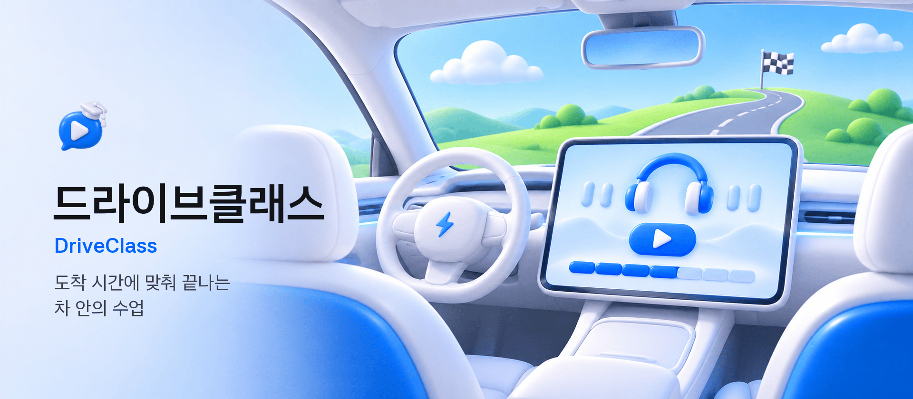
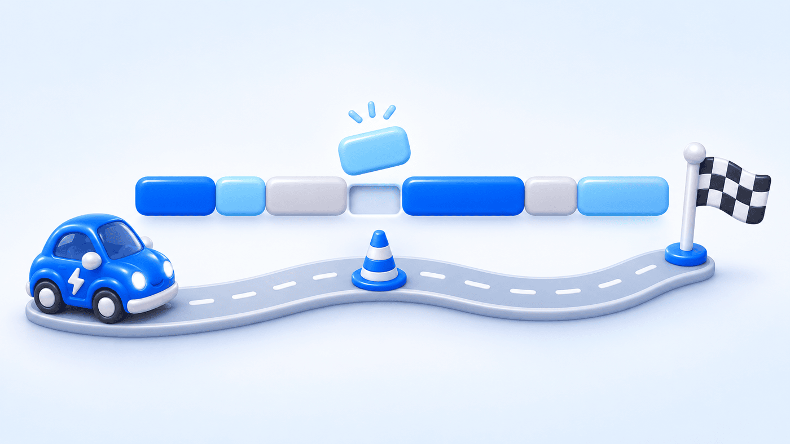
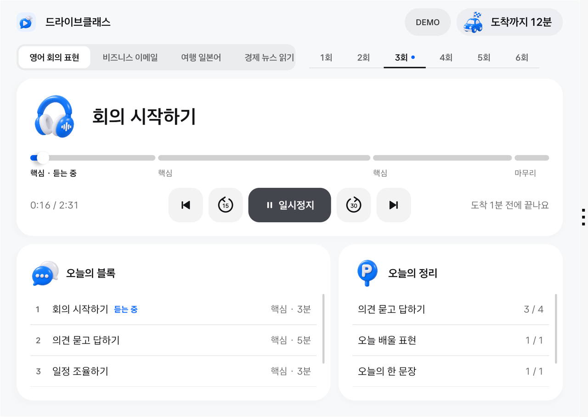
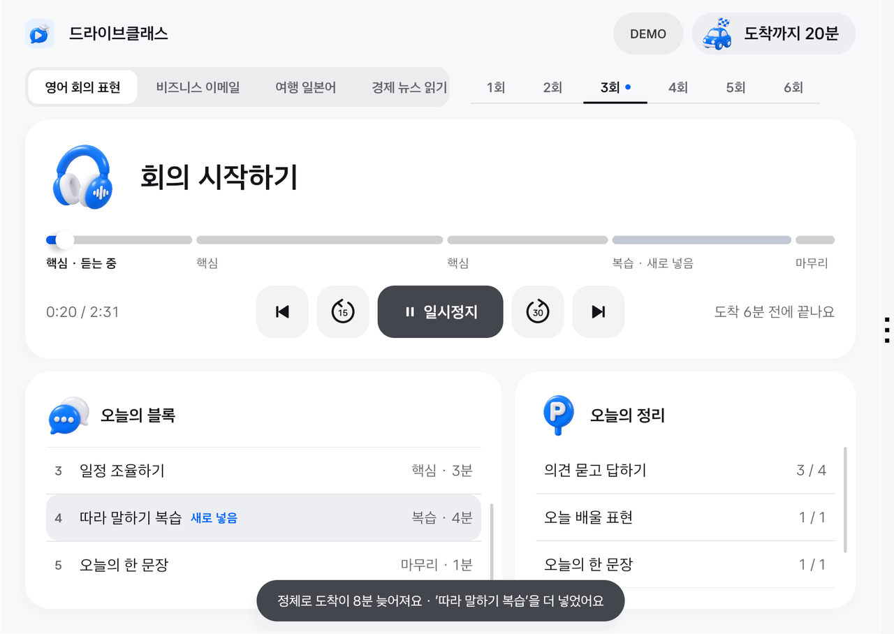
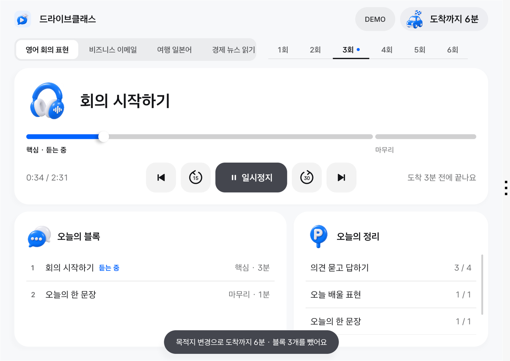
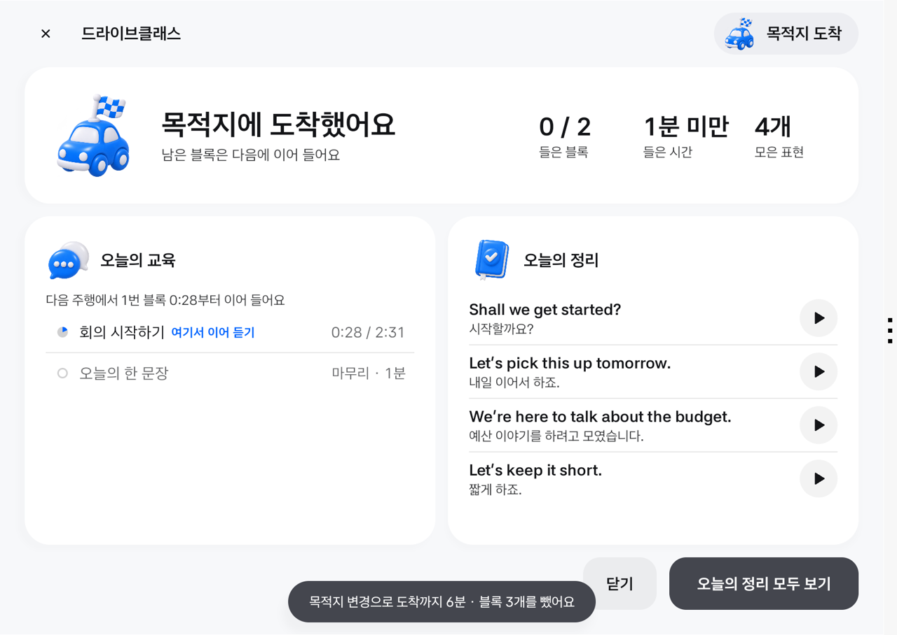
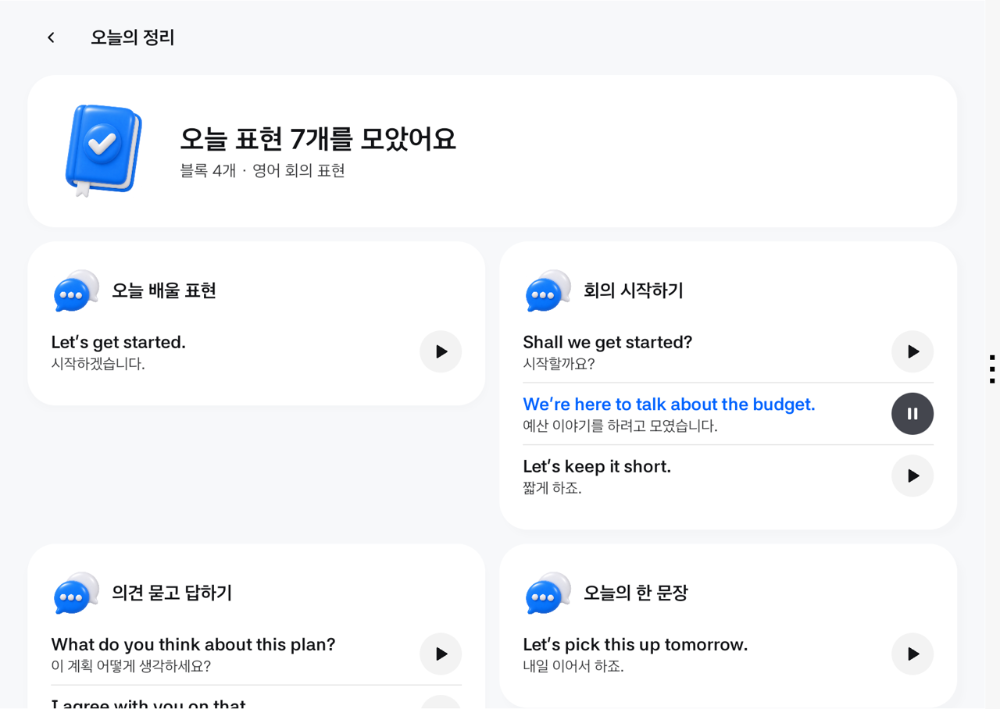
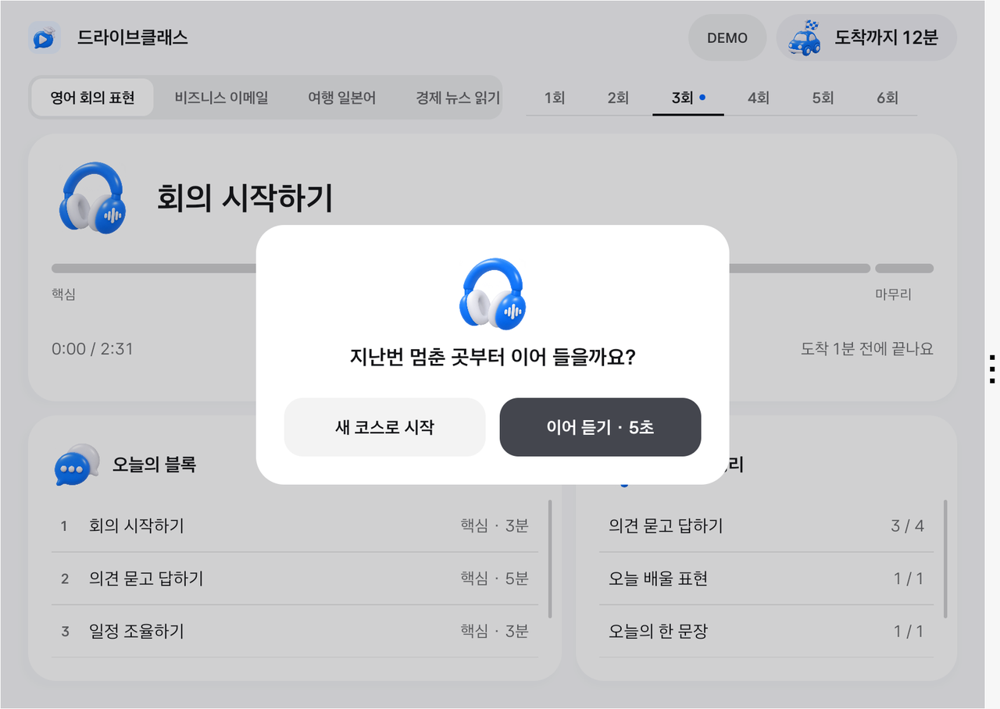
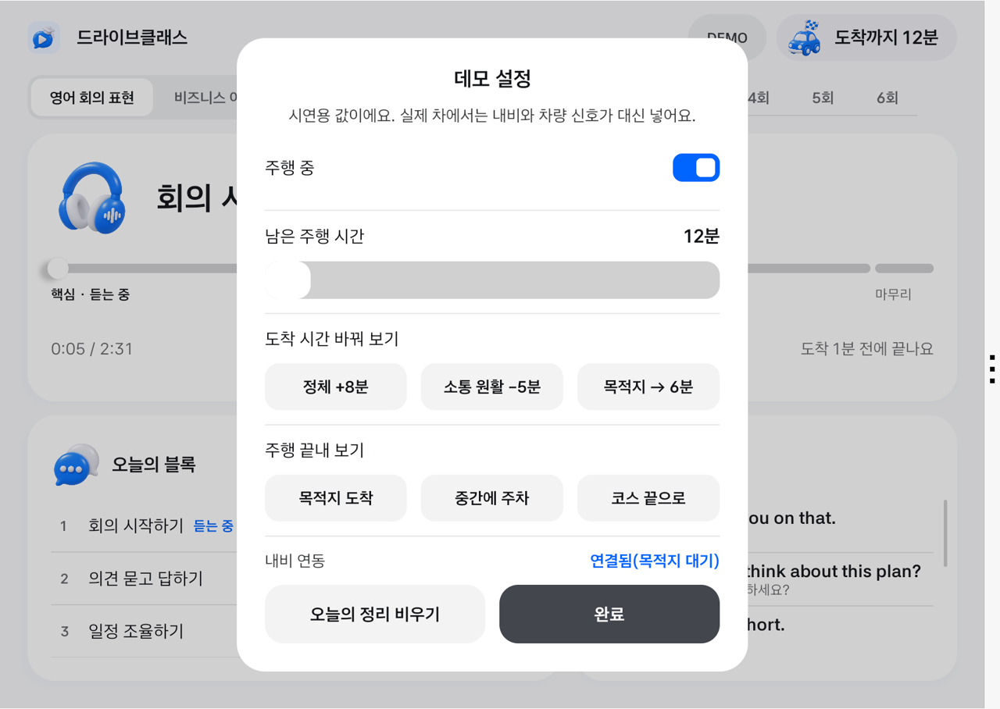
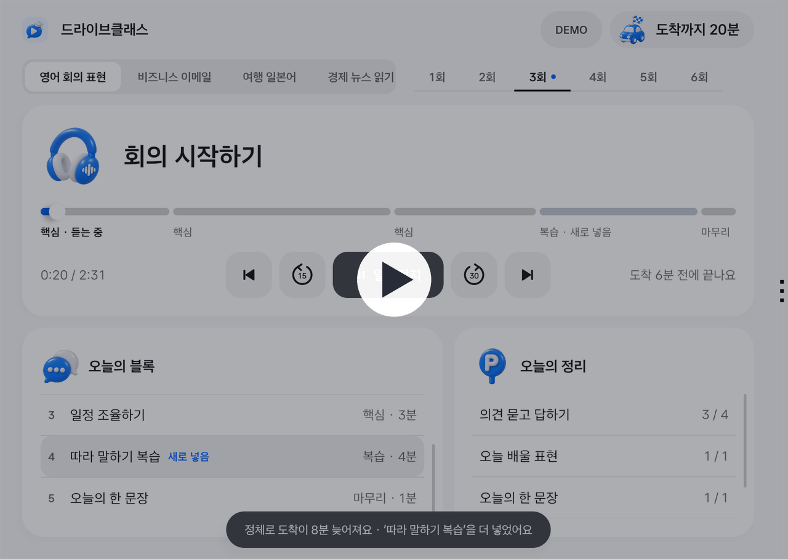

<p align="center">
  
</p>

<h1 align="center">DriveClass · 드라이브클래스</h1>

<p align="center">
  <b>남은 주행 시간만큼만 수업을 짜고, 도착 시간이 바뀌면 다시 짜 주는 Pleos Connect 학습 앱</b><br>
  현대자동차그룹 차량용 앱 개발 공모전 출품작 · 팀 weareone
</p>

<p align="center">
  <a href="https://youtu.be/tXkACPz7rqQ">시연 영상</a> ·
  <a href="apk/weareone_DriveClass_release.apk">APK</a> ·
  <a href="#빠른-시작">빠른 시작</a> ·
  <a href="#구현-상태">구현 상태</a>
</p>

---

## 개요

| 구분 | 설명 |
| --- | --- |
| **편성** | 내비가 알려 준 "도착까지 남은 시간" 안에 끝나도록 1·3·5분 오디오 블록으로 수업 한 편을 짭니다. |
| **재편성** | 정체나 목적지 변경으로 도착 시간이 바뀌면, 듣던 블록은 그대로 두고 남은 코스만 다시 짭니다. |
| **종료·이어 듣기** | 도착하면 강의를 멈추고, 오늘 들은 블록과 모은 표현을 한 화면에 정리합니다. 다음 주행에서 멈춘 곳부터 이어 듣습니다. |
| **실행 환경** | Pleos Connect 에뮬레이터 v2.1.0(Android Automotive, API 34), 화면 2560×1440에서 확인했습니다. |
| **Pleos 연동** | NaviHelper(경로 안내의 남은 시간), Pleos 디자인 시스템 토큰·컴포넌트, 미디어 세션(스티어링 휠 미디어 키) |

<br>

## 배경

출퇴근길 운전 시간은 매일 생기지만 길이가 매번 다릅니다. 20분짜리 강의를 틀면 12분 만에 도착해 중간에 끊기고, 정체가 생기면 들을 것이 먼저 떨어집니다. 운전 중에는 화면을 만져 다음 강의를 고를 수도 없습니다.

드라이브클래스는 강의를 짧은 블록(도입·핵심·복습·마무리)으로 나눠 두고, **남은 주행 시간에 맞는 블록만 골라 한 편으로 묶습니다.** 운전자는 재생만 누르면 됩니다.

<p align="center">
  
</p>

<br>

## 화면

<table>
  <tr>
    <td width="50%"><br><b>① 출발: 남은 시간에 맞춘 코스</b><br>도착까지 12분이면 10분 코스를 짜고, "도착 N분 전에 끝나요"로 알려 줍니다. 진행 막대의 칸 하나가 블록 하나입니다.</td>
    <td width="50%"><br><b>② 정체 +8분: 블록 추가</b><br>듣던 블록은 끊지 않고, 늘어난 시간만큼 복습 블록을 뒤에 넣습니다. 바뀐 내용은 토스트와 "새로 넣음" 표시로 알립니다.</td>
  </tr>
  <tr>
    <td><br><b>③ 목적지 변경: 블록 덜어 내기</b><br>도착이 6분으로 줄면 남은 블록을 빼고 마무리 블록으로 코스를 끝냅니다.</td>
    <td><br><b>④ 도착: 멈추고 정리</b><br>강의를 일시정지하고 들은 블록·시간·모은 표현을 보여 줍니다. 표현 옆 재생 버튼은 원문 다음 번역을 들려줍니다.</td>
  </tr>
  <tr>
    <td><br><b>⑤ 오늘의 정리 (정차 전용)</b><br>모은 문장을 블록별로 다시 보고 듣습니다. 주행 중에는 열리지 않습니다.</td>
    <td><br><b>⑥ 다시 출발: 이어 듣기</b><br>중간에 주차했다가 다시 출발하면 멈춘 곳부터 이어 들을지 묻고, 답이 없으면 자동으로 이어 듣습니다.</td>
  </tr>
</table>

<br>

## 편성 규칙

- **도착 전에 끝냅니다.** 남은 시간보다 긴 코스는 짜지 않습니다. 순서는 도입 → 핵심 → 복습 → 마무리이며, 15분 이하의 짧은 주행에서는 도입을 빼고 핵심부터 시작합니다.
- **듣던 블록은 자르지 않습니다.** 다시 짤 때 바뀌는 것은 아직 듣지 않은 뒤쪽 블록뿐입니다. 도착이 갑자기 당겨져 듣던 블록이 남은 시간보다 길어져도 그 블록은 끊지 않습니다.
- **작은 변화에는 움직이지 않습니다.** 재생 중에는 도착 예정이 3분 이상 달라질 때만 다시 짭니다(`Planner.REPLAN_THRESHOLD_SEC`). 다만 일시정지 등으로 남은 강의가 도착 시간을 넘기게 되면 변화가 작아도 다시 짭니다.
- **바뀌면 이유를 말합니다.** "정체로 도착이 8분 늦어져요", "목적지 변경으로 도착까지 6분"처럼 원인과 결과를 한 줄로 알립니다.
- **주행 중에는 읽을 것을 줄입니다.** 문장으로 된 정리 화면은 정차 중에만 열립니다.

편성 엔진은 차량 API에 의존하지 않는 순수 Kotlin 모듈(`:engine`)입니다. 단위 테스트 10개는 이 중 편성 계산(코스 길이, 블록 추가·제거, 듣던 블록 유지, 들은 블록 제외, 3분 기준, 도착 시간 초과 판단)을 확인합니다. 알림 문구와 정차 전용 화면은 에뮬레이터에서 손으로 확인했습니다.

<br>

## 구현 상태

실제로 동작하는 것과 시연용으로 대신한 것을 나눠 적습니다.

| 항목 | 상태 | 설명 |
| --- | --- | --- |
| 남은 시간에 맞춘 편성 | ✅ 동작 | `Planner.plan()` |
| 도착 시간 변경 시 재편성 | ✅ 동작 | `Planner.replan()`, 듣던 블록 유지 |
| 내비 연동 | ✅ 동작 | Pleos NaviHelper로 경로 안내의 남은 시간(초)과 새 경로 시작을 받음. 에뮬레이터 내비에서 61분 경로로 확인 |
| 오디오 재생 | ✅ 동작 | Media3 `MediaLibraryService`. 미디어 세션으로 스티어링 휠 키·시스템 미디어 위젯과 연결 |
| 주행 종료 화면 | ✅ 동작 | 도착, 중간 주차, 코스 완료(도착 임박/시간 남음), 이어 듣기 팝업 |
| 오늘의 정리와 문장 재생 | ✅ 동작 | 원문 → 번역 순서로 재생 |
| Pleos 디자인 시스템 | ✅ 적용 | 색·글자·간격 토큰과 버튼·스위치·슬라이더·팝업 규격 |
| 주행 여부 판단 | ⚠️ 시연용 | 차량 신호(기어·속도) 대신 DEMO 창의 '주행 중' 스위치로 넣음 |
| 콘텐츠 | ⚠️ 샘플 | '영어 회의 표현 3회' 블록 6개(약 14분)만 들을 수 있음. 다른 과목·회차는 목록만 표시 |
| 음성 | ⚠️ 샘플 | 강의·문장 오디오는 합성 음성 |

오른쪽 위 **DEMO** 버튼은 실제 차에서 내비와 차량 신호가 넣는 값을 손으로 바꿔 보는 시연 도구입니다.

<p align="center"></p>

<br>

## 빠른 시작

Pleos Connect 에뮬레이터(또는 Android Automotive 에뮬레이터)에 APK를 설치합니다.

```bash
adb install -r apk/weareone_DriveClass_release.apk
```

1. 앱을 열고 **재생**을 누릅니다. 도착까지 12분에 맞춘 4블록 코스가 시작됩니다.
2. **DEMO → 주행 중 켜기 → 정체 +8분.** 도착 20분, 복습 블록이 뒤에 붙고 토스트가 뜹니다.
3. **DEMO → 목적지 → 6분.** 남은 블록 3개를 빼고 마무리 블록만 남깁니다.
4. **DEMO → 목적지 도착.** 강의가 멈추고 종료 화면이 뜹니다. 표현 옆 ▶를 눌러 문장을 듣습니다.
5. **오늘의 정리 모두 보기**에서 모은 문장을 확인합니다.
6. (선택) **DEMO → 중간에 주차** 후 앱을 종료했다가 다시 열어 '주행 중'을 켜면 이어 듣기 팝업이 뜹니다.

DEMO 창에서 바꾼 값은 창을 닫고 0.5초 뒤에 적용됩니다. 내비 경로 안내가 켜져 있으면 남은 시간은 내비 값을 따릅니다. 이때 DEMO 창에서 시간을 바꾸면 내비가 다음 값을 보낼 때까지만 유지됩니다.

<br>

## 시연 영상

<p align="center">
  <a href="https://youtu.be/tXkACPz7rqQ"></a><br>
  <a href="https://youtu.be/tXkACPz7rqQ"><b>▶ YouTube에서 보기</b></a> (1분 28초)
</p>

에뮬레이터 화면 녹화에 설명 음성과 앱 소리를 번갈아 넣었습니다. 원본 파일은 [`docs/demo/weareone_DriveClass_demo.mp4`](docs/demo/weareone_DriveClass_demo.mp4), 구간별 내용은 [`docs/demo/README.md`](docs/demo/README.md)에 있습니다.

<br>

## 구조

```
내비(NaviHelper) ─ 남은 시간 ─┐
DEMO 창(시연용) ─────────────┤→ TripStateSource → Planner(:engine) → PlaybackService(Media3) → 화면(Compose)
차량 신호(예정) ─ 주행 여부 ──┘
```

| 모듈 | 내용 |
| --- | --- |
| `engine` | 순수 Kotlin 편성 엔진. `Planner.plan()`, `Planner.replan()`, 단위 테스트 |
| `app` | Compose 화면(주행·종료·정리), Media3 재생 서비스, 주행 상태 소스, Pleos 디자인 토큰 |
| `content` | 샘플 강의 대본과 오디오 생성 스크립트 |
| `docs` | 디자인 시안, 시연 영상과 녹화·합성 스크립트 |

기술: Kotlin, Jetpack Compose, Media3, Pleos NaviHelper 3.0.5 · minSdk 29, targetSdk 34

<br>

## 빌드

필요한 것: JDK 17, Android SDK(platform 36).

```bash
./gradlew :engine:test
```

```bash
./gradlew :app:assembleDebug
```

```bash
adb install -r app/build/outputs/apk/debug/app-debug.apk
```

release 빌드는 `./gradlew :app:assembleRelease`입니다. 서명 키(`release.jks`, `keystore.properties`)는 저장소에 없으며, 없으면 서명되지 않은 APK가 만들어집니다.

<br>

## 테스트 환경

- **Pleos Connect 에뮬레이터 v2.1.0**(API 34, 화면 2560×1440): 내비에서 경로 안내(1시간 1분)를 시작하면 "도착까지 61분"이 뜨고 블록 6개로 편성되는 것, 재생·재편성·종료 화면·문장 재생을 확인했습니다.
- **일반 Android Automotive 에뮬레이터**(API 36): 내비 서비스가 없어 DEMO 창의 값으로 동작합니다.

<br>

## 로드맵

- 차량 신호(기어·속도)로 주행·정차를 판단해 DEMO 스위치를 대체
- 학습 기록을 바탕으로 한 복습 블록 추천
